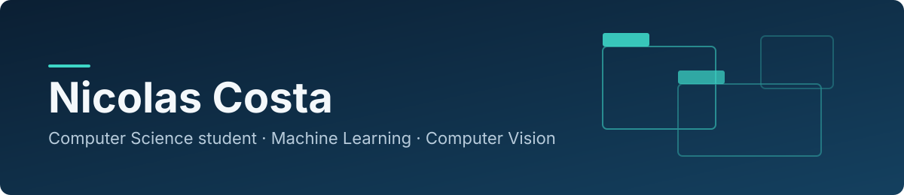

  

## About me

I'm a Computer Science student at PUC Minas, in Brazil, and I work as a Data Labeler at IVEX, a European startup building technology for ADAS (advanced driver assistance systems).

My work started with annotating images for computer vision models. Over time it grew to include writing and maintaining the Python pipelines that prepare those datasets. I'm interested in Machine Learning, Computer Vision and the data work that makes models usable, and that is the direction I'm building my skills in.

Before IVEX, I worked in technical support for public management systems, which taught me how to write clear bug reports for developers.

## What I do at IVEX

- Annotate images with CVAT for object detection models
- Develop and maintain Python pipelines to process and curate large image datasets
- Write image deduplication routines for large datasets
- Use Pandas to analyze and transform structured data inside those pipelines
- Write scripts that move datasets to and from AWS S3
- Investigate and fix performance and memory problems in data processing jobs
- Work with PyTorch, OpenCV and detection models (YOLOv8, Faster R-CNN) in annotation and data analysis workflows

The code and data from this work belong to the company, so none of it is published here.

## Tools I've used

| Area | Tools |
| --- | --- |
| Language | Python |
| Machine Learning and Computer Vision | PyTorch, OpenCV, YOLOv8, Faster R-CNN |
| Data | Pandas |
| Annotation | CVAT |
| Infrastructure and workflow | Docker, Ubuntu/Linux, Git and GitHub, AWS S3 |

<!--
FEATURED PROJECTS: uncomment this block when the first project is public.
Keep each row to one sentence about the problem and the result.
Add a "Demo" column only when there is a real demo link to put in it.

## Projects

| Project | What it is | Stack |
| --- | --- | --- |
| [project-name](https://github.com/NickyCosta/project-name) | One sentence on what it does and what you learned or measured. | Python, PyTorch |
-->

## Focus

- Machine Learning and Computer Vision
- Dataset quality and data pipelines
- Perception for ADAS and autonomous driving
- Getting my personal projects ready to publish here

## Education

B.Sc. in Computer Science, PUC Minas (in progress)

## Contact

- LinkedIn: [linkedin.com/in/nicolas-bc](https://www.linkedin.com/in/nicolas-bc)
- Location: Poços de Caldas, Minas Gerais, Brazil
