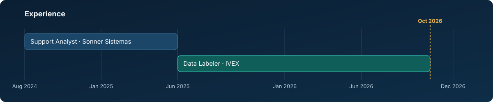

  

## About me

I'm a Computer Science student at PUC Minas, in Brazil, and I work as a Data Labeler at IVEX, a European startup building technology for ADAS (advanced driver assistance systems).

My work started with annotating images for computer vision models. Over time it grew to include building the Python pipelines that prepare those datasets and training the models themselves. I'm interested in Machine Learning, Computer Vision and the data work that makes models usable, and that is the direction I'm building my skills in.

Before IVEX, I worked in technical support for public management systems, which taught me how to write clear bug reports for developers.

## What I can do

- **Train and evaluate detection and segmentation models.** Custom datasets with the YOLO family (YOLOv8, YOLO11) and Faster R-CNN, including a road segmentation model and a traffic sign detector that I moved from Faster R-CNN to YOLOv8, evaluated with mAP.
- **Build dataset pipelines.** Image deduplication with ResNet-18 embeddings and FAISS, run in shards with checkpoints so hundreds of thousands of images do not crash the machine, plus an automated funnel that prepares data before training.
- **Make annotation faster.** Model-assisted labeling in CVAT with models served through Nuclio, and a scripted setup that brings the whole stack up from one shortcut.
- **Build labeling tools.** A stylus-first web client for outlining road surface on a tablet: a FastAPI backend, a TypeScript frontend, two-way sync with CVAT, an offline mode and a COCO backup of the day's work. Roughly 5,700 lines of source and 2,600 lines of tests. I also built a smaller tool for flagging doubtful frames and exporting them in the team's format.

This work was done for a company, so the code and data are not public.

## Experience

  

## Tools

  &nbsp;
  &nbsp;
  &nbsp;
  &nbsp;
  

  &nbsp;
  &nbsp;
  &nbsp;
  &nbsp;
  &nbsp;
  &nbsp;
  &nbsp;
  &nbsp;
  

Also: Ultralytics YOLO, Faster R-CNN, CVAT, FAISS, Nuclio, GitHub, AWS S3, WSL2 and CUDA. TypeScript, HTML, CSS, Vite and FastAPI come from the labeling tool, whose interface uses plain TypeScript and the DOM. React and JavaScript come from a coursework project.

<!--
FEATURED PROJECTS: uncomment this block when the first project is public.
Keep each row to one sentence about the problem and the result.
Add a "Demo" column only when there is a real demo link to put in it.

## Projects

| Project | What it is | Stack |
| --- | --- | --- |
| [project-name](https://github.com/NickyCosta/project-name) | One sentence on what it does and what you learned or measured. | Python, PyTorch |
-->

<!--
ACTIVITY GRAPHS: uncomment only when your own repositories have real commits.
These widgets read public GitHub data for your account, so with no commits they
render empty. They are hosted by a third party (github-readme-stats), so check
that they load before leaving them on the profile.

## Activity

  

-->

## Focus

- Machine Learning and Computer Vision
- Dataset quality and data pipelines
- Perception for ADAS and autonomous driving
- Getting my personal projects ready to publish here

## Education

B.Sc. in Computer Science, PUC Minas (in progress)

## Contact

- LinkedIn: [linkedin.com/in/nicolas-bc](https://www.linkedin.com/in/nicolas-bc)
